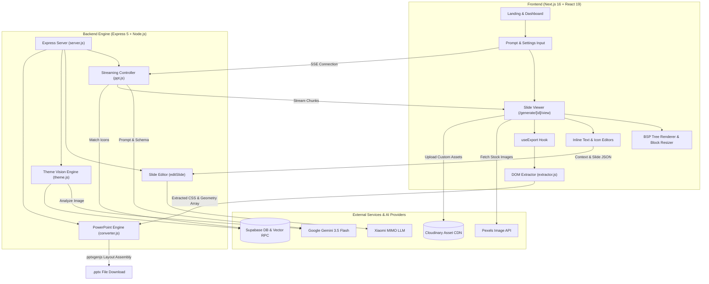
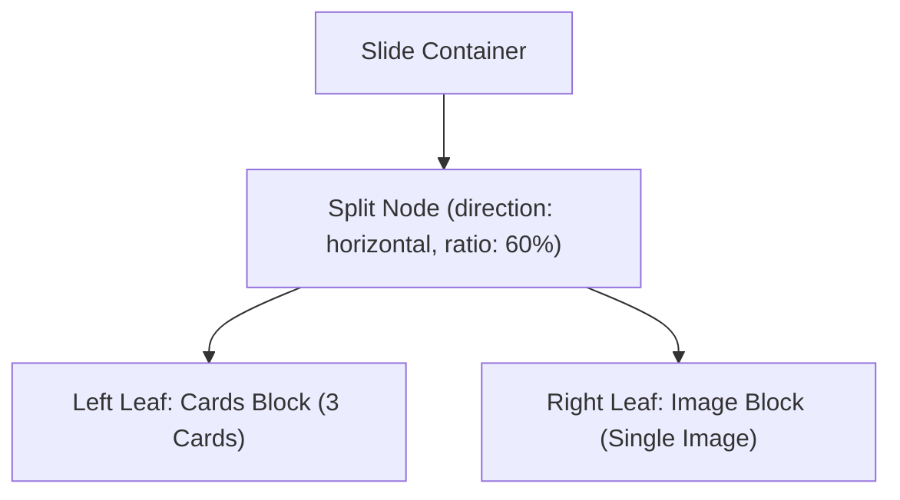
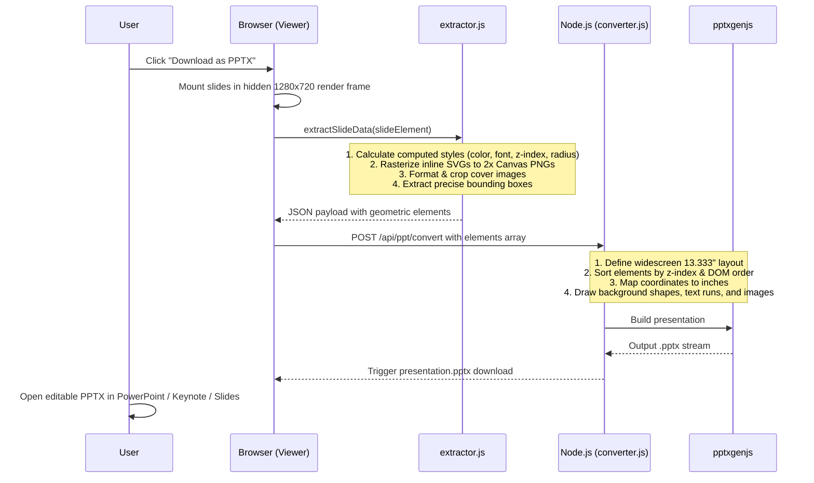

# PPT Gen — AI-Powered Presentation Engine & Visual Slide Platform

<div align="center">

**Turn raw prompts, briefs, and ideas into structured, beautifully styled, interactive presentations in seconds.**

[Features](#-key-features) • [Architecture](#-system-architecture) • [Slide & Layout Engine](#-slide-layout--bsp-engine) • [Export Pipeline](#-high-fidelity-export-pipeline) • [Tech Stack](#-technology-stack) • [Getting Started](#-getting-started) • [API Overview](#-api-routes--endpoints)

</div>

---

## 📖 Overview

**PPT Gen** is a full-stack, AI-native presentation creation and editing platform. It re-imagines how slide decks are authored, styled, and exported:

1. **AI Generation with Live SSE Streaming**: Uses Google Gemini and MIMO LLMs to generate presentation structure, copy, and layout schemas while streaming tokens via Server-Sent Events (SSE). Slides appear and render incrementally as the model thinks.
2. **Binary Space Partitioning (BSP) Slide Architecture**: Slides are not rigid static templates; they are built on a recursive split-tree model with interactive resizers, supporting complex multi-column, multi-row, and nested layouts.
3. **Container Query Width (`cqw`) Scaling Engine**: All layout geometry, typography, and spacing scale proportionally across editing canvases, thumbnail strips, fullscreen presentation displays, and export frames without layout breakage.
4. **Intelligent Theme Engine with Vision AI**: Features 15+ curated palettes and an AI Vision tool that ingests reference images or moodboards, checks WCAG contrast/luminance polarities, and automatically derives fully accessible themes.
5. **Pixel-Accurate Native PowerPoint (.pptx) Export**: Instead of simple screenshots, a custom DOM extraction engine calculates bounding boxes, typography, computed colors, and vector SVGs, transmitting layout metadata to a Node.js engine that builds native editable shapes and text runs using `pptxgenjs`.

---

## ✨ Key Features

### ⚡ Real-Time Streaming Generation (SSE)
- Generates decks of custom lengths (1 to 15+ slides), tone profiles, and content densities.
- Streams responses through [ppt_engine2/controllers/ppt.js](file:///d:/Documents/Web%20Dev/PPT_gen/ppt_engine2/controllers/ppt.js).
- Employs `partial-json-parser` on incoming chunks so users observe slide cards, outlines, and theme selections materializing live.

### 📐 Adaptive Block Layout System
- **Macro Layouts**: Standard, Split-Left Image, Split-Right Image, Top Image Banner, and Full-Bleed Backgrounds.
- **Micro Block Types** (defined in [frontend/ppt_gen/components/templates/layouts/layout_map.js](file:///d:/Documents/Web%20Dev/PPT_gen/frontend/ppt_gen/components/templates/layouts/layout_map.js)):
  - **Cards**: Basic, Outline, Numbered, Accent.
  - **Bullets**: Simple, Grid, Numbered, Accent.
  - **Timelines**: Horizontal, Chevron, Vertical, Alternating.
  - **Stats**: High-impact Stat Callouts, Metric Grids.
  - **Icons**: Icon List, Feature Grid, Icon Cards.
  - **Charts**: Dynamic Bar, Line, Area, and Pie Charts.
  - **Basic**: Data Tables, Code Blocks, Large Quotes, Plain Text, Single Images, and Image Galleries.

### 🎨 Intelligent Theme & Vision AI Palette Extraction
- 15+ built-in themes (Modern Light, Dark Mode, Corporate, Minimalist, Creative, Dracula, Lavender, Ocean, Sunset, etc.) styled via [frontend/ppt_gen/components/templates/themes.css](file:///d:/Documents/Web%20Dev/PPT_gen/frontend/ppt_gen/components/templates/themes.css).
- **Vision AI Theme Generator**: Upload any inspiration image, screenshot, or brand guideline. The AI vision model extracts primary, surface, accent, and background colors with built-in luminance calculation guards that prevent unreadable low-contrast combinations.

### 🛠️ In-Place WYSIWYG Editor & Slide AI Co-Pilot
- **Inline Editing**: Direct click-to-edit typography via `<EditableElement>`.
- **Drag-to-Resize Splits**: Interactive `<BlockResizer>` allows fluidly dragging divider lines between BSP partitions.
- **Single-Slide AI Refinement (`editSlide`)**: Prompt the AI to rewrite, expand, or restyle an individual slide while preserving existing image assets and slide context.
- **Asset Library & Search**: Instant Pexels stock photography search, Phosphor & Lucide icon picker with vector keyword matching, and custom Cloudinary user asset uploads.
- **History Management**: Comprehensive Undo/Redo stack (`Ctrl+Z` / `Ctrl+Y`).

### 📦 High-Fidelity Dual Export
- **Native PowerPoint (`.pptx`)**: Generates true PowerPoint presentation files with real editable text boxes, vector shapes, and formatted images.
- **Vector / High-Res PDF (`.pdf`)**: Browser-rendered print export with automated container overflow inspection to prevent clipped text.

### 🎭 Fullscreen Interactive Presenter Mode
- Distraction-free presentation view with keyboard controls (`Space`, `ArrowRight`, `ArrowLeft`, `Escape`).
- Motion transitions powered by GSAP and `<AnimatedItem>` for smooth staggered element reveals.

### 🔗 Sharing & Quota System
- Toggle public sharing to generate shareable viewer links (`/share/[id]`).
- Atomic credit-based generation system with automated refunds if a streaming pipeline or LLM query fails.

---

## 🏗️ System Architecture

PPT Gen uses a decoupled, dual-tier monorepo architecture designed for high responsiveness, real-time streaming, and reliable background conversions.



---

## 🧩 Slide Layout & BSP Engine

Slides are modeled as a **Binary Space Partitioning (BSP) Tree** ([frontend/ppt_gen/components/templates/Slide.jsx](file:///d:/Documents/Web%20Dev/PPT_gen/frontend/ppt_gen/components/templates/Slide.jsx)):



### Design Standards & Rules
Developers contributing block layouts must follow the guidelines established in [.agents/AGENTS.md](file:///d:/Documents/Web%20Dev/PPT_gen/.agents/AGENTS.md):
- **Responsive Units**: Always use `cqw` (container query width) units for font sizes, padding, margins, borders, and gap styles so slides look identical on small previews, tablet screens, and widescreen projectors.
- **Custom Theme Classes**: Avoid hardcoded Tailwind color utilities (e.g. `bg-blue-500`). Use semantic theme utilities defined in [themes.css](file:///d:/Documents/Web%20Dev/PPT_gen/frontend/ppt_gen/components/templates/themes.css) (`theme-bg-primary`, `theme-text-primary`, `theme-bg-alt`, `theme-card-bg`, etc.).
- **No Single-Sided CSS Borders**: The PowerPoint extraction engine requires explicit elements for dividers. Use dedicated `<div>` or `<span>` elements with explicit widths/heights and background colors instead of `border-l-*` or `border-t-*`.
- **Icon Flexibility**: Always render icons using `<EditableIcon>` to enable user customization and keyword searches.
- **Motion Orchestration**: Wrap mapped list or grid children in `<AnimatedItem index={i}>` for staggered transitions.

---

## 🖨️ High-Fidelity Export Pipeline

PPT Gen uses a proprietary extraction and conversion mechanism to bridge web layout with Microsoft PowerPoint:



---

## 💻 Technology Stack

### Frontend (`frontend/ppt_gen`)
- **Framework**: [Next.js 16](https://nextjs.org/) (App Router, Turbopack) & [React 19](https://react.dev/)
- **Styling**: [Tailwind CSS v4](https://tailwindcss.com/), `@tailwindcss/postcss`, `tw-animate-css`
- **UI Components**: [Radix UI](https://www.radix-ui.com/), [shadcn/ui](https://ui.shadcn.com/), Lucide Icons, Phosphor Icons
- **Animation & Motion**: [GSAP 3](https://greensock.com/gsap/) (`@gsap/react`, `ScrollTrigger`), Framer Motion
- **Smooth Scroll**: [Lenis](https://lenis.darkroom.engineering/)
- **State & Data**: [Zustand](https://github.com/pmndrs/zustand), React Context, Sonner Toasts
- **Auth**: [NextAuth v5 Beta](https://authjs.dev/)
- **Export Tools**: `html2canvas-pro`, `jspdf`, custom DOM extractor

### Backend Engine (`ppt_engine2`)
- **Runtime & Server**: [Node.js](https://nodejs.org/), [Express 5](https://expressjs.com/)
- **AI & LLM Services**: Google Gemini API (`gemini-3.5-flash-lite`, Vision API), Xiaomi MIMO API (`mimo-v2.6-flash`), OpenAI SDK
- **Database & Auth**: [Supabase](https://supabase.com/) (PostgreSQL with Custom RPC functions)
- **Media & Assets**: [Cloudinary](https://cloudinary.com/), [Pexels API](https://www.pexels.com/api/)
- **PowerPoint Synthesis**: [PptxGenJS](https://gitbrent.github.io/PptxGenJS/)
- **Parsing & Streaming**: `partial-json-parser`, Server-Sent Events (SSE), Multer

---

## 📁 Repository Structure

```
PPT_gen/
├── .agents/
│   └── AGENTS.md                  # Development rules for slide components & theme engine
├── frontend/
│   └── ppt_gen/                   # Next.js frontend application
│       ├── app/
│       │   ├── api/auth/          # NextAuth authentication endpoints
│       │   ├── dashboard/         # User presentations, themes, & theme generator
│       │   ├── generate/          # Main generator, previewer, and slide viewer
│       │   │   └── [id]/view/     # Interactive slide editor workspace
│       │   ├── share/[id]/        # Public view-only presentation route
│       │   └── globals.css        # Global styles & Tailwind entry
│       ├── components/
│       │   ├── dashboard/         # Dashboard tabs & custom theme preview cards
│       │   ├── generate/          # Toolbars, floating controls, and modals
│       │   ├── landing/           # Landing page hero, features, and silky aurora
│       │   ├── templates/         # Slide system: Slide.jsx, ContentBlock, HeaderBlock
│       │   │   ├── layouts/       # 20+ micro-layout blocks (cards, bullets, charts...)
│       │   │   ├── metadata.json  # Theme and block schemas
│       │   │   └── themes.css     # CSS variable definitions for all themes
│       │   └── ui/                # shadcn primitives & editable elements
│       ├── hooks/                 # Custom hooks (editor, export, autosave, themes)
│       └── utils/
│           └── extractor.js       # High-fidelity DOM to PPTX data extractor
├── ppt_engine2/                   # Express.js backend & conversion engine
│   ├── controllers/
│   │   ├── ppt.js                 # Generation, SSE streaming, and editing handlers
│   │   ├── theme.js               # Theme CRUD & Vision AI theme extractor
│   │   ├── library.js             # User asset management
│   │   └── user.js                # Profile & credit transactions
│   ├── engine/
│   │   ├── converter.js           # HTML data to PptxGenJS slide builder
│   │   └── utils.js               # Geometry scaling, color math, and font resolution
│   ├── routes/                    # API route definitions
│   ├── services/                  # Database, image/icon search, and credit services
│   ├── utils/                     # LLM chat wrappers, prompt engineering, and SSE helpers
│   └── server.js                  # Express application entrypoint
└── README.md                      # Project documentation
```

---

## 🚀 Getting Started

### Prerequisites
- **Node.js**: v18.18.0 or later (Node 20+ recommended)
- **Package Manager**: `npm`, `pnpm`, or `yarn`
- **External Accounts / API Keys**:
  - Google Gemini API Key
  - Xiaomi MIMO API Key *(Optional, fallback support)*
  - Supabase Project URL & Anon/Service Role Key
  - Pexels API Key *(For stock imagery)*
  - Cloudinary Account *(For user image uploads)*
  - Google OAuth Credentials *(For NextAuth)*

---

### 1. Backend Configuration (`ppt_engine2`)

1. Navigate to the backend directory:
   ```bash
   cd ppt_engine2
   ```

2. Install dependencies:
   ```bash
   npm install
   ```

3. Configure environment variables. Create a `.env` file in `ppt_engine2/`:
   ```env
   PORT=8080
   NODE_ENV=development
   FRONTEND_URL=http://localhost:3000

   # LLM Keys
   GEMINI_API_KEY=your_gemini_api_key
   MIMO_API_KEY=your_mimo_api_key

   # Database (Supabase)
   SUPABASE_URL=https://your-project.supabase.co
   SUPABASE_KEY=your_supabase_service_role_key

   # Authentication & Security
   AUTH_SECRET=your_jwt_and_session_secret

   # External Stock Assets
   PEXEL_KEY=your_pexels_api_key

   # Cloudinary Media Storage
   CLOUDINARY_CLOUD_NAME=your_cloud_name
   CLOUDINARY_API_KEY=your_cloudinary_key
   CLOUDINARY_API_SECRET=your_cloudinary_secret
   ```

4. Start the backend development server:
   ```bash
   npm run dev
   ```
   *The server will start at `http://localhost:8080`.*

---

### 2. Frontend Configuration (`frontend/ppt_gen`)

1. Navigate to the frontend directory:
   ```bash
   cd frontend/ppt_gen
   ```

2. Install dependencies:
   ```bash
   npm install
   ```

3. Configure environment variables. Create a `.env` file in `frontend/ppt_gen/`:
   ```env
   NEXT_PUBLIC_BACKEND_URL=http://localhost:8080
   NEXT_PUBLIC_HOSTED_URL=http://localhost:3000

   # NextAuth v5 Configuration
   AUTH_SECRET=your_shared_auth_secret
   GOOGLE_CLIENT_ID=your_google_oauth_client_id
   GOOGLE_CLIENT_SECRET=your_google_oauth_client_secret
   ```

4. Launch the Next.js development server:
   ```bash
   npm run dev
   ```
   *Open [http://localhost:3000](http://localhost:3000) in your browser.*

---

## 📡 API Routes & Endpoints

### Presentation & Slide Operations (`/api/ppt`)
| Method | Route | Description | Auth Required |
|---|---|---|---|
| `POST` | `/api/ppt/generate` | Initiates asynchronous presentation generation | Yes |
| `GET` | `/api/ppt/stream/:ppt_id` | Server-Sent Events (SSE) streaming slide generation | Yes |
| `POST` | `/api/ppt/edit-slide` | Modifies an existing slide via natural language prompt | Yes |
| `POST` | `/api/ppt/convert` | Receives extracted DOM geometry and returns `.pptx` file | No |
| `GET` | `/api/ppt/all` | Retrieves all presentations belonging to the authenticated user | Yes |
| `GET` | `/api/ppt/:ppt_id` | Fetches presentation details and slide JSON | Yes |
| `PUT` | `/api/ppt/:ppt_id` | Updates slide content, order, or theme | Yes |
| `DELETE`| `/api/ppt/:ppt_id` | Deletes a presentation deck | Yes |
| `GET` | `/api/ppt/search/images` | Searches stock images using the Pexels API | Yes |
| `GET` | `/api/ppt/search/icons` | Queries Phosphor/vector icons via keyword search | Yes |

### Theme Management (`/api/themes`)
| Method | Route | Description | Auth Required |
|---|---|---|---|
| `GET` | `/api/themes` | Lists custom user themes | Yes |
| `POST` | `/api/themes` | Saves a new custom theme | Yes |
| `POST` | `/api/themes/extract-from-image` | Extracts accessible theme palette from an uploaded image via Gemini Vision | Yes |
| `PATCH`| `/api/themes/:id` | Updates an existing custom theme | Yes |
| `DELETE`| `/api/themes/:id` | Deletes a custom theme | Yes |

### Sharing & Collaboration (`/api/share`)
| Method | Route | Description | Auth Required |
|---|---|---|---|
| `POST` | `/api/ppt/share/:ppt_id` | Toggles public sharing on or off | Yes |
| `GET` | `/api/share/:ppt_id` | Public read-only endpoint to view a shared deck | No |

---

## 🤝 Contributing & Code Guidelines

When contributing new components or modifying the layout engine:
1. Review the guidelines in [.agents/AGENTS.md](file:///d:/Documents/Web Dev\PPT_gen\.agents\AGENTS.md).
2. Adhere to **SOLID principles** across all services and components.
3. Test layout scaling across multiple viewport sizes using container query classes (`cqw`).
4. Ensure all colors respect the `[data-theme]` CSS variables defined in [themes.css](file:///d:/Documents/Web%20Dev/PPT_gen/frontend/ppt_gen/components/templates/themes.css).

---

<div align="center">
  <sub>Crafted with passion for the next generation of visual storytelling.</sub>
</div>
